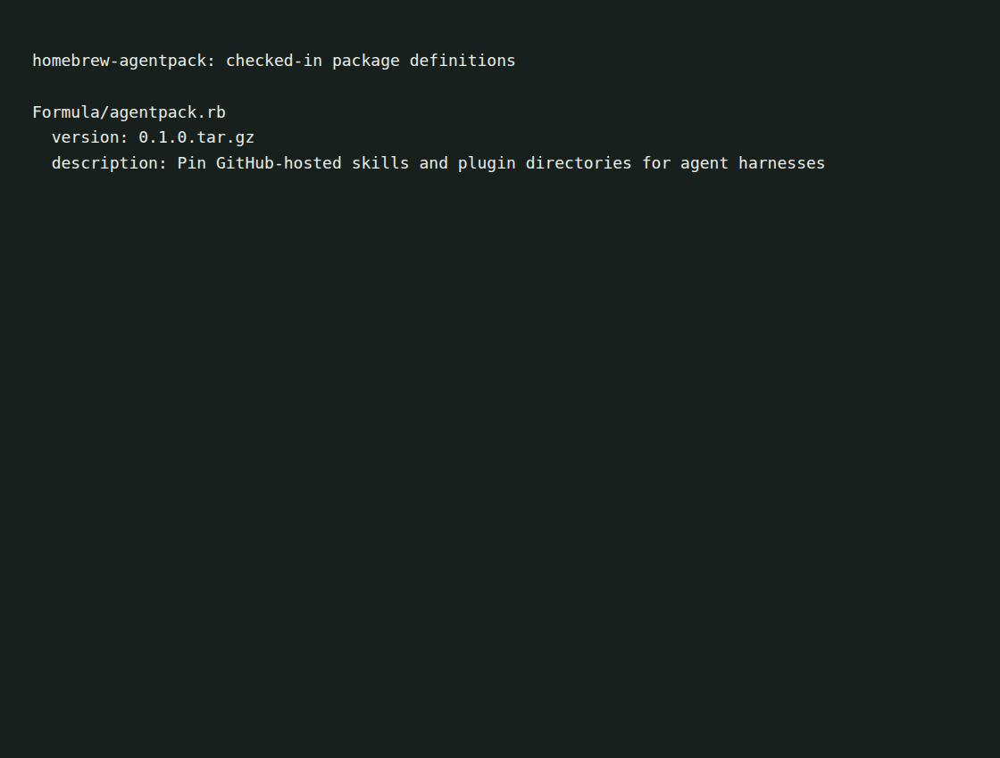

# homebrew-agentpack

A legacy Homebrew tap for [agentpack](https://github.com/olegpustovit/agentpack).
Its formula builds the Rust-based v0.1.0 release from source.



The capture shows repository metadata, not a completed installation.
See [capture notes](docs/demo/README.md).

## Current and legacy packages

This repository's formula is pinned to v0.1.0. It does not install the newer
Go-based agentpack release. For the newer binary package, inspect the
[current tap](https://github.com/olegpustovit/homebrew-tap).

If you specifically need the legacy source build:

```sh
brew tap olegpustovit/agentpack
brew install olegpustovit/agentpack/agentpack
```

The formula depends on Homebrew's Rust package for compilation. This installation
path has not been exercised here. `brew upgrade` follows this formula's pinned
version; it does not automatically select a newer upstream tag.

## Maintenance

[Formula/agentpack.rb](Formula/agentpack.rb) is the source of truth for the release
URL, checksum and build command. Check the formula rather than assuming it follows the latest upstream tag.
